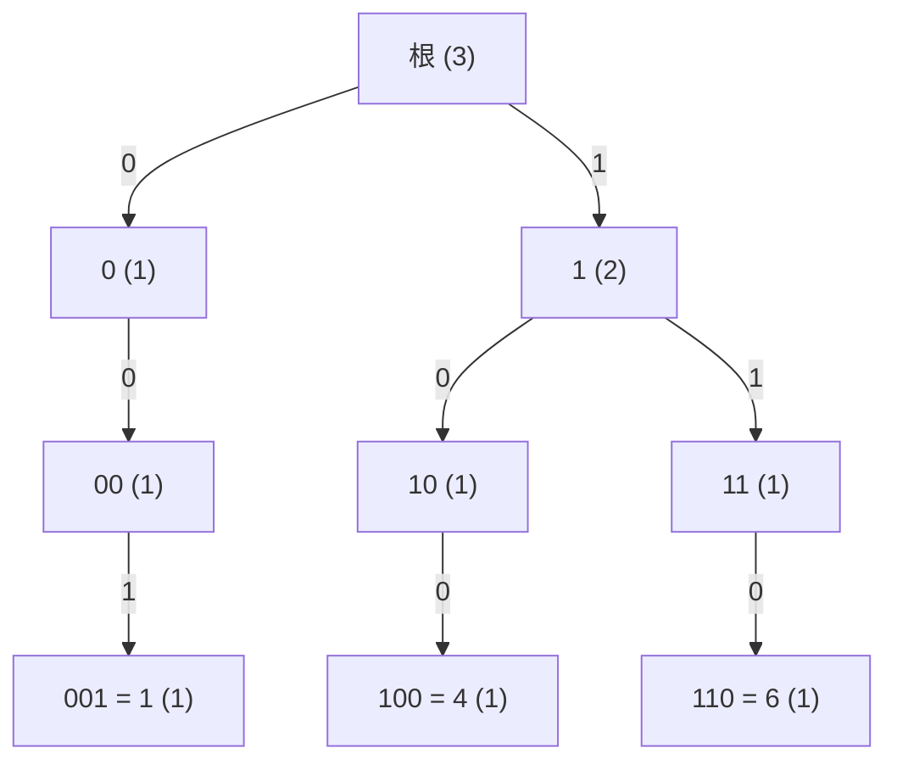

#データ構造 #xor #トライ

ライブラリ：[binary_trie.hpp](https://github.com/winter-2521/cp-library/blob/main/data_structure/binary_trie.hpp)

## 1. 概要

本記事では、非負整数の（多重）集合を管理する **2 分トライ（Binary Trie）** を解説します。2 分トライを使うと、集合 $S$ への追加・削除をしながら、与えられた $x$ について

- $\min_{y \in S} (x \oplus y)$（$\oplus$ は bit ごとの xor）
- $\{x \oplus y : y \in S\}$ の中で小さい方から $k$ 番目
- $x \oplus y < a$ となる $y$ の個数

を、どれも値のビット数 $L$ に比例する時間 $O(L)$ で求められます。

>[!問題] 問題 1：Set Xor-Min（Library Checker）
>空の集合 $S$ があります。次のクエリを $Q$ 回処理してください（$Q \le 5 \times 10^5$、$0 \le x < 2^{30}$）。
>- `0 x`：$S$ に $x$ がなければ追加する
>- `1 x`：$S$ に $x$ があれば削除する
>- `2 x`：$\min_{y \in S} (x \oplus y)$ を出力する

## 2. 前提知識

- 2 進数と bit ごとの xor（$\oplus$）
- 二分木

## 3. 素朴な方法

### 3.1. 全部試す

$S$ の全要素 $y$ について $x \oplus y$ を計算して最小を取れば答えです。1 回 $O(|S|)$ なので、$5 \times 10^5$ 回のクエリで最悪 $10^{11}$ 回の計算になり、間に合いません。

### 3.2. ソートして二分探索？

「$x$ に近い値を探す」なら $S$ をソートして二分探索すればよいですが、xor は大小関係を保ちません。例えば $x = 4 = 100_{(2)}$ に対して、

- $y = 3 = 011_{(2)}$ は値としては $x$ のすぐ隣ですが、$x \oplus y = 111_{(2)} = 7$
- $y = 5 = 101_{(2)}$ は $x \oplus y = 001_{(2)} = 1$

です。xor の大きさは「値の近さ」ではなく「**上の方のビットがどれだけ一致しているか**」で決まります。

## 4. xor の最小値は上のビットから決まる

2 進数の大小は、**上のビットから見て最初に異なるビット** で決まります。例えば $0\underline{1}11_{(2)} = 7$ と $1\underline{0}00_{(2)} = 8$ では、一番上のビットが小さい 7 の方が、下のビットがすべて 1 でも小さくなります。

したがって $x \oplus y$ を最小にするには、

1. まず一番上のビットで $x \oplus y$ を 0 にしたい。つまり $y$ の一番上のビットが $x$ と同じものがあれば、それらだけに絞る（なければ仕方なく 1 になる）。
2. 絞った中で、次のビットも同じように 0 にしたい。
3. …を一番下のビットまで繰り返す。

という **上のビットからの貪欲** で答えが決まります。これを速くするには、「上位ビットが ○○ で始まる $y$ が $S$ に残っているか」をすぐ調べられればよく、そのために $S$ の要素を **上のビットから読んだ 2 分木（トライ）** に入れます。

## 5. 2 分トライ

### 5.1. 構造

値を $L$ ビットの 2 進数とみて、上のビットから 1 ビットずつ読みながら、0 なら左の子、1 なら右の子へ進みます。根から深さ $L$ の葉までの道が、1 つの値を表します。各ノードには、そのノードの下にある値の個数 `cnt` を持たせます。

例として $L = 3$、$S = \{1, 4, 6\}$（2 進で $001$, $100$, $110$）のトライは次のようになります（ノードの中の文字列は「ここまでに読んだビット」、括弧内が `cnt`）。



「上位ビットが 1 で始まる値は 2 個（4 と 6）」が、ノード「1」の `cnt = 2` から分かります。

ライブラリでは、ノードを配列で持ち、各ノードは子の番号 `ch[0]`, `ch[1]`（なければ 0）と `cnt` を持ちます。ライブラリで上の例を作ったときの配列は次の通りです（番号 0 が根）。

| 番号 | 表すビット列 | `ch[0]` | `ch[1]` | `cnt` |
| --- | --- | --- | --- | --- |
| 0 | （根） | 1 | 4 | 3 |
| 1 | 0 | 2 | — | 1 |
| 2 | 00 | — | 3 | 1 |
| 3 | 001 | — | — | 1 |
| 4 | 1 | 5 | 7 | 2 |
| 5 | 10 | 6 | — | 1 |
| 6 | 100 | — | — | 1 |
| 7 | 11 | 8 | — | 1 |
| 8 | 110 | — | — | 1 |

### 5.2. 追加と削除

- **insert(x)**：根から $x$ のビットを上から順にたどり、子がなければ新しく作ります。通ったノード（根と葉を含む）の `cnt` を 1 増やします。
- **erase(x)**：同じ道をたどって `cnt` を 1 減らします。ノードは消さず、`cnt = 0` のまま残します（消す処理を省いて速くするため）。

どちらも $O(L)$ です。

### 5.3. xor の最小値

4 節の貪欲をそのまま書くと次のようになります。

1. 根から始め、答えを 0 にする。
2. 上のビットから順に、$x$ のそのビットを $c$ とする。
   - 子 `ch[c]` があって `cnt > 0` なら、そちらへ進む（xor のこのビットは 0）。
   - なければ `ch[1-c]` へ進み、答えのこのビットを 1 にする。

**例：$S = \{1, 4, 6\}$、$x = 5 = 101_{(2)}$**（実際の値は $1 \oplus 5 = 4$、$4 \oplus 5 = 1$、$6 \oplus 5 = 3$ なので答えは 1）

| 見るビット | $c$ | `ch[c]` | 進む先 | 答えのビット |
| --- | --- | --- | --- | --- |
| 2 | 1 | ノード「1」(cnt 2) がある | 「1」 | 0 |
| 1 | 0 | ノード「10」(cnt 1) がある | 「10」 | 0 |
| 0 | 1 | ノード「101」はない | 「100」 | 1 |

答えは $001_{(2)} = 1$ で、正しく $y = 4$ にたどり着いています。

### 5.4. 全体に xor した集合の $k$ 番目

$T = \{x \oplus y : y \in S\}$ の小さい方から $k$ 番目（0-indexed）を考えます。各ノードで、

- 「xor のこのビットが 0 になる側」（`ch[c]`）の値は、反対側の値より必ず小さい
- その個数は `ch[c]` の `cnt`

なので、二分探索木で $k$ 番目を探すのと同じように降りられます。

1. 上のビットから、`ch[c]` の `cnt` を $z$ とする（子がなければ 0）。
2. $k < z$ なら `ch[c]` へ（答えのビットは 0）。
3. そうでなければ $k$ から $z$ を引いて `ch[1-c]` へ（答えのビットは 1）。

**例：$k = 1$、$x = 5$**（$T = \{4, 1, 3\}$ を並べると $1, 3, 4$ なので答えは 3）

| 見るビット | $c$ | $z$ | 判定 | $k$ | 進む先 | 答えのビット |
| --- | --- | --- | --- | --- | --- | --- |
| 2 | 1 | 「1」の cnt = 2 | $1 < 2$ | 1 | 「1」 | 0 |
| 1 | 0 | 「10」の cnt = 1 | $1 \ge 1$ | 0 | 「11」 | 1 |
| 0 | 1 | 「111」はない → 0 | $0 \ge 0$ | 0 | 「110」 | 1 |

答えは $011_{(2)} = 3$ です。

### 5.5. xor した値が $a$ 未満の個数

上のビットから、$a$ のそのビットを見ます。

- $a$ のビットが 1 なら、「xor のこのビットが 0 になる側」（`ch[c]`）の値はすべて、ここまでで $a$ と同じで、このビットが $a$ より小さいので、**すべて $a$ 未満** です。その `cnt` を答えに足してから、`ch[1-c]` へ進みます（xor のビットが $a$ と同じ 1 の側で、まだ大小が決まっていない）。
- $a$ のビットが 0 なら、`ch[c]` へ進むだけです（反対側は xor のビットが 1 で、$a$ より大きいことが確定）。

**例：$a = 3 = 011_{(2)}$、$x = 5$**（$\{4, 1, 3\}$ のうち 3 未満は 1 だけなので答えは 1）

| 見るビット | $a$ のビット | $c$ | 足す | 進む先 |
| --- | --- | --- | --- | --- |
| 2 | 0 | 1 | — | 「1」 |
| 1 | 1 | 0 | 「10」の cnt = 1 | 「11」 |
| 0 | 1 | 1 | 「111」はない → 0 | 「110」 |

答えは 1 です。

### 5.6. 実装

xor の最小値の部分は次の通りです（`d[v]` がノード、`LOG` がビット数）。

```cpp
T xor_min(T x) const {
    int v = 0;            // 根
    T res = 0;
    for (int b = LOG - 1; b >= 0; b--) {
        int c = (x >> b) & 1;
        int to = d[v].ch[c];
        if (to && d[to].cnt) v = to;                         // xor のこのビットを 0 にできる
        else v = d[v].ch[c ^ 1], res |= T(1) << b;           // できないので 1
    }
    return res;
}
```

最大値 $\max (x \oplus y)$ は、$x$ の全ビットを反転したものの最小値を求めて、もう一度全ビットを反転すれば得られます（`xor_max`）。

## 6. 計算量とメモリ

どの操作も根から葉まで 1 本降りるだけなので $O(L)$ です。ノードは追加した値の **種類ごとに最大 $L$ 個** 増えます。問題 1 で $5 \times 10^5$ 回すべて異なる値を追加すると、ノードは最大 $1.5 \times 10^7$ 個（1 個 12 バイトで約 180 MB）になります。

## 7. 問題

【問題 1】Set Xor-Min は、`insert_unique`（なければ追加）、`erase_one`（あれば削除）、`xor_min` で、各クエリをメソッド 1 回で処理できます。

【問題 2】長さ $N$ の数列 $a$ について、$a_l \oplus a_{l+1} \oplus \cdots \oplus a_{r-1}$ の最大値を求めてください（$0 \le l < r \le N$）。
（ヒント：累積 xor $s_i = a_0 \oplus \cdots \oplus a_{i-1}$ を使うと、区間の xor は $s_r \oplus s_l$ です。$r$ を増やしながら、それまでの $s_l$ をトライに入れておきましょう。）

### 関連問題

- [Set Xor-Min (Library Checker)](https://judge.yosupo.jp/problem/set_xor_min)
- [ABC308 G - Minimum Xor Pair Query](https://atcoder.jp/contests/abc308/tasks/abc308_g)：集合への追加・削除と「2 要素の xor の最小値」。

## 8. まとめ

- xor の大きさは「上のビットがどこまで一致しているか」で決まるので、上のビットからの貪欲で最小値が求まる。
- 値を上のビットから読んだ 2 分木（トライ）に入れ、各ノードに個数を持つと、貪欲・$k$ 番目・個数がどれも 1 本降りるだけで求まる。
- 「全体に $x$ を xor する」のは、各段で $x$ のビットが 1 なら左右を入れ替えて見るのと同じなので、木を作り直す必要はない。

## 9. 参考文献

- [Library Checker - Set Xor-Min](https://judge.yosupo.jp/problem/set_xor_min)
- [AtCoder アルゴリズム講座 - Wavelet Matrix 基礎](https://info.atcoder.jp/entry/algorithm_lectures/wavelet_matrix_basic)（3 節で Binary Trie を復習しています）
