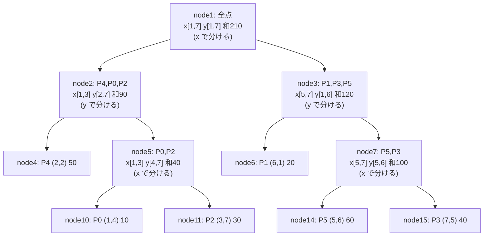

#データ構造 #2次元 #平方分割 #二進カウンタ

ライブラリ：[kd_tree.hpp](https://github.com/winter-2521/cp-library/blob/main/data_structure/kd_tree.hpp)

## 1. 概要

本記事では、平面上の値付きの点に対して

- 長方形 $[l, r) \times [d, u)$ の中の点の値の和（積）
- 長方形の中の点の値への作用（全部を $a w + b$ にする、など）
- 一点の値の変更、点の追加

を処理するデータ構造 **k-d 木** を解説します。長方形の操作は $O(\sqrt n)$ です。遅延セグメント木の「区間」を「長方形」に広げたものと考えられます。

>[!問題] 問題 1：Dynamic Point Set Rectangle Affine Rectangle Sum（Library Checker）
>重み付きの点に「点の追加」「点 $i$ の重みを $w$ に」「長方形の中の重みの和」「長方形の中の各点の重みを $a w + b$ に」を $Q$ 回処理してください。（$N, Q \le 10^5$）

## 2. 前提知識

- 遅延セグメント木（作用付きモノイド、遅延の伝播）：[[遅延セグ木まとめ]]
- 中央値で分ける（`nth_element`）

## 3. 素朴な方法

長方形のクエリのたびに全点を見ると 1 回 $O(n)$、全体 $O(nq) = 10^{10}$ で間に合いません。

長方形の **和だけ** なら、ウェーブレット行列などで $O(\log n)$ にできます（[[長方形の中の点の重みの和（Rectangle Sum）]]）。しかし「長方形の中の点に作用」は、1 次元の遅延セグメント木のように「区間 = 木の $O(\log n)$ 個のノード」に分けることができず、別の工夫が要ります。

## 4. k-d 木の構造

### 4.1. 点の集合を半分ずつに分ける

点の集合を **$x$ 座標の中央値で 2 つに分け、それぞれを $y$ 座標の中央値で 2 つに分け、次はまた $x$ で …** と、軸を交互に変えながら半分ずつに分けた二分木を作ります。各ノードは「担当する点たち」について次を持ちます。

| 名前 | 意味 |
| --- | --- |
| 外接長方形 | 担当する点を囲む最小の長方形 $[x_0, x_1] \times [y_0, y_1]$ |
| `val` | 担当する点の値の和（積） |
| `lz` | 子にまだ伝えていない作用 |

### 4.2. 例

6 点 $P_0(1, 4)$, $P_1(6, 1)$, $P_2(3, 7)$, $P_3(7, 5)$, $P_4(2, 2)$, $P_5(5, 6)$、重みは順に 10, 20, 30, 40, 50, 60 とします。ライブラリで作った木は次の通りです。



根では $x$ の中央値で $\{x = 1, 2, 3\}$ と $\{x = 5, 6, 7\}$ に分かれ、その下では $y$ で分かれています。ノード番号はセグメント木と同じく、ノード $k$ の子が $2k, 2k + 1$ です。

## 5. 長方形の操作

### 5.1. 手順

長方形 $R$ について、根から再帰的に次をします。

1. ノードの外接長方形が $R$ と **交わらない** → 何もしない（和なら 0 を返す）。
2. 外接長方形が $R$ に **含まれる** → ノードの `val` をそのまま使う（作用なら `val` と `lz` に作用させて止める）。
3. それ以外 → 遅延を子に伝えて（push）、2 つの子に再帰する。作用なら、戻ってから `val` を子から計算し直す。

遅延セグメント木の「区間に含まれる / 交わらない / 一部重なる」が、「長方形に含まれる / 交わらない / 一部重なる」になっただけです。

### 5.2. 例で追う：$[2, 7) \times [2, 7)$ の和

閉区間で言うと $2 \le x \le 6$, $2 \le y \le 6$ です。中に入る点は $P_4(2, 2)$ と $P_5(5, 6)$ なので、答えは $50 + 60 = 110$ です。

| ノード | 外接長方形 | 判定 | 結果 |
| --- | --- | --- | --- |
| node1 | x[1,7] y[1,7] | 一部 | 子へ |
| node2 | x[1,3] y[2,7] | 一部（$x_0 = 1 < 2$） | 子へ |
| node4 | (2,2) | 含まれる | **50** |
| node5 | x[1,3] y[4,7] | 一部 | 子へ |
| node10 | (1,4) | 交わらない（$x < 2$） | 0 |
| node11 | (3,7) | 交わらない（$y = 7$） | 0 |
| node3 | x[5,7] y[1,6] | 一部 | 子へ |
| node6 | (6,1) | 交わらない（$y < 2$） | 0 |
| node7 | x[5,7] y[5,6] | 一部（$x_1 = 7$） | 子へ |
| node14 | (5,6) | 含まれる | **60** |
| node15 | (7,5) | 交わらない（$x = 7$） | 0 |

合計 110 です。続けてこの長方形の点に「+100」を作用させると、含まれるノード node4・node14 で止まって遅延が付き、全体の和は $210 + 200 = 410$ になります（ライブラリで確認しました）。

## 6. 計算量：なぜ $O(\sqrt n)$ か

「一部重なる」ノードの数を数えれば十分です（「含まれる」「交わらない」ノードは、一部重なるノードの子として 1 回ずつ見るだけなので）。

一部重なるノードの外接長方形は、$R$ の 4 辺のどれかをまたいでいます。そこで **1 本の縦線 $x = c$ をまたぐノードの数** を数えます。

- $x$ で分けるノードでは、2 つの子は「中央値より左の点」と「右の点」なので、縦線をまたげるのは **片方の子だけ** です。
- $y$ で分けるノードでは、**両方の子** がまたぐことがあります。

軸を交互にしているので、2 段降りるごとに「またぐノード」は高々 2 倍になります。木の深さは $\log_2 n$ なので、またぐノードは合計で $2^{(\log_2 n)/2} = \sqrt n$ 程度です。4 辺で $O(\sqrt n)$ です。

## 7. 遅い分け方と高速化

### 7.1. 遅い分け方：広がりの大きい軸で分ける

最初の実装では、軸を交互にせず「外接長方形の幅と高さのうち **大きい方の軸** で分ける」ことにしていました。点がばらけていれば速いのですが、

- $x$ は $0$〜$10^9$ に散らばり、$y$ は $0$〜$99$ の 100 種類しかない

という入力（Library Checker の hack ケース）では、幅の方がずっと大きいので **ずっと $x$ で分け続けます**。すると 6 節の「片方の子だけ」が $y$ の線について一度も起きず、「$y$ の細い帯」のクエリ（$x$ はほぼ全部、$y$ は $[6, 87)$ のような範囲）では、ほとんどのノードが帯の境界をまたぎます。手元で測ると 1 クエリあたり約 14 万ノード（ほぼ全ノード）を訪れ、全体で **108 秒** かかりました。

### 7.2. 高速化：深さで軸を交互にする

深さが偶数なら $x$、奇数なら $y$ で分けるようにすると、6 節の議論がどんな入力でも成り立ちます。同じケースで 1 クエリ約 2500 ノード、全体 **2.7 秒** になりました。

```cpp
// 深さごとに x, y を交互に，中央値で分ける
It m = b + (e - b) / 2;
bool by_x = (31 - __builtin_clz(k)) % 2 == 0;   // ノード番号 k の深さ
if (by_x) nth_element(b, m, e, [&](int i, int j) { return xs[i] < xs[j]; });
else nth_element(b, m, e, [&](int i, int j) { return ys[i] < ys[j]; });
```

## 8. 点の追加：二進カウンタ

### 8.1. 遅い方法

k-d 木は中央値で分けた形をしているので、点を 1 つ追加するだけで形が崩れます。追加のたびに作り直すと 1 回 $O(n \log n)$ です。

### 8.2. 大きさ 2 冪のかたまりに分ける

点を「大きさ $1, 2, 4, \ldots$ のかたまり」に分け、かたまりごとに k-d 木を作ります（[[長方形の中の点の重みの和（Rectangle Sum）]] の 6 節と同じ二進カウンタです）。

- **長方形の操作**：全部のかたまりにします。大きさが 2 冪で相異なるので、合計 $\sqrt n + \sqrt{n/2} + \sqrt{n/4} + \cdots = O(\sqrt n)$ です。
- **追加**：同じ大きさのかたまりを併合して作り直します。このとき、併合するかたまりの遅延を **全部葉まで降ろしてから**、現在の値で作り直します。
- **一点更新**：点 $i$ がどのかたまりの何番目にあるかを覚えておき、そのかたまりで根から葉まで遅延を伝えてから値を書き換え、根まで計算し直します。

## 9. 正しさ

ノードの `val` は「担当する点の値に、そのノードより上の遅延を除く全ての作用をかけたものの積」です。作用が積と可換（`mapping(f, op(a, b)) = op(mapping(f, a), mapping(f, b))`）なので、含まれるノードに直接作用させてよいのは遅延セグメント木と同じです。ただし点の並びに順番はないので、**積は可換** である必要があります。

## 10. 問題

【問題 1】は `DynamicKDTree<int, ActedAffineSum<mint>>` の `add_point`, `set`, `prod`, `apply` で、各クエリをメソッド 1 回で処理できます。

【問題 2】平面上の点に「長方形の中の点の値を $\max(w, x)$ にする（chmax）」「長方形の中の最小値」を処理してください。
（ヒント：作用付きモノイドを「区間 chmax・区間最小値」に変えるだけです。chmax は最小値と可換に作用します。）

### 関連問題

- [Dynamic Point Set Rectangle Affine Rectangle Sum (Library Checker)](https://judge.yosupo.jp/problem/dynamic_point_set_rectangle_affine_rectangle_sum)

## 11. まとめ

- 点の集合を $x$, $y$ の中央値で交互に半分ずつに分けた木の各ノードに、外接長方形・積・遅延を持たせる。
- 長方形の操作は遅延セグメント木と同じ再帰で、一部重なるノードは $O(\sqrt n)$ 個。
- 軸は必ず交互にする。広がりの大きい軸で分けると、偏った入力で $O(n)$ になる。
- 追加は二進カウンタで、大きさ 2 冪のかたまりごとに k-d 木を持つ。

## 12. 参考文献

- J. L. Bentley, "Multidimensional binary search trees used for associative searching", Communications of the ACM, 1975.
- [Library Checker - Dynamic Point Set Rectangle Affine Rectangle Sum](https://judge.yosupo.jp/problem/dynamic_point_set_rectangle_affine_rectangle_sum)
